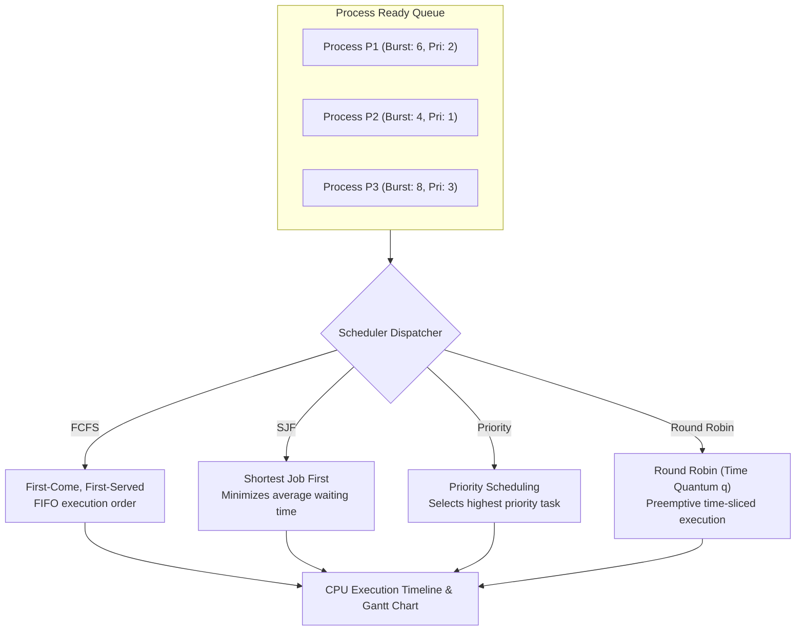

# Integrated National Citizen Services Platform

[](https://www.python.org/)
[]()
[]()
[]()
[]()

An academic full-stack prototype and simulation platform developed for the **Operating Systems (CCSE0303A)** Project-Based Learning (PBL) curriculum. It pairs a **Citizen Services Management Portal** with an interactive **CPU Scheduling Simulation Lab** demonstrating real-world operating system mechanics.

---

## 🏛️ System Architecture

The project is structured into two complementary application servers running purely on the Python standard library:

```mermaid
graph TD
    subgraph CitizenPortal["1. Citizen Portal & Admin System (:8000)"]
        Citizen([Citizen User]) -->|"1. Submit Request"| WebApp["web_app.py<br/>(HTTP Server & Router)"]
        WebApp -->|"2. Validate & Assign Ref"| Validator["Input Validation Engine"]
        Validator -->|"3. Persist State"| JSONStore[("data/citizen_applications.json")]
        Admin([Platform Administrator]) -->|"4. Review & Update Status"| AdminPage["admin_page.py<br/>(Session Auth & Controls)"]
        AdminPage -->|"5. Update Record"| JSONStore
    end

    subgraph OSLab["2. OS CPU Scheduling Lab (:8001)"]
        Student([Student / Evaluator]) -->|"Configure Processes & Quantum"| LabServer["os_lab_app.py<br/>(Simulation Server)"]
        LabServer --> SchedCore["Scheduler Engine (scheduler.py)"]
        SchedCore -->|"Algorithm Selection"| Algos["FCFS / SJF / Priority / Round Robin"]
        Algos --> Metrics["Turnaround, Waiting Time & Gantt Chart"]
        Metrics -->|"Render Visual Metrics"| LabServer
    end
```



---

## ⚙️ Operating System Scheduling Mechanics

The OS Lab simulator (`os_lab_app.py`) demonstrates multi-programming process scheduling across standard operating system algorithms:



---

## 🧪 Comprehensive Verification Suite

The repository has zero external package dependencies (pure Python standard library) and features an extensive automated test suite covering 166 test cases across both Phase 1 and Phase 2:

### Phase 1 Core Scheduler Tests (12 Tests)
```bash
python -m pytest tests/
```
```text
tests/test_scheduler.py .......                                          [ 58%]
tests/test_storage.py .....                                              [100%]
============================= 12 passed in 0.43s ==============================
```

### Phase 2 End-to-End Portal Tests (154 Tests)
```bash
python -m unittest discover -s phase-2/tests
```
```text
Ran 154 tests in 18.49s
OK (All citizen endpoints, admin security, status transitions & scheduling invariants verified)
```

---

## 🚀 Running the Services

### Prerequisites
* **Python**: 3.10 or newer (No pip packages required!)

### 1. Launch the Citizen Portal & Admin System

```bash
# Optional: Set admin credentials for demo
export CIVICONE_ADMIN_PASSWORD="local-admin-demo"
# Windows PowerShell:
# $env:CIVICONE_ADMIN_PASSWORD="local-admin-demo"

# Start the portal server
python web_app.py
```
* **Citizen Portal**: Open [http://127.0.0.1:8000](http://127.0.0.1:8000) to browse services, submit synthetic applications, and track progress by reference ID.
* **Administrator Console**: Open [http://127.0.0.1:8000/admin](http://127.0.0.1:8000/admin) to review queue entries, filter by status, and approve/reject applications.

### 2. Launch the CPU Scheduling Lab

In a separate terminal:

```bash
python os_lab_app.py
```
* Open [http://127.0.0.1:8001](http://127.0.0.1:8001) to interactively generate synthetic processes, switch between FCFS, SJF, Priority, and Round Robin algorithms, and inspect real-time Gantt charts.

---

## 📂 Repository Structure

```text
Integrated-National-Citizen-Services-Platform/
├── web_app.py                 # Citizen portal web application (Port 8000)
├── admin_page.py              # Administrative dashboard & status triage
├── os_lab_app.py              # Standalone CPU scheduling simulator (Port 8001)
├── os_platform/               # Core OS modeling modules
│   ├── models.py              # Process control block (PCB) & request abstractions
│   ├── scheduler.py           # Scheduling algorithms implementation
│   └── storage.py             # Atomic file persistence helpers
├── phase-1/                   # Phase 1 milestone deliverables & baseline tests
├── phase-2/                   # Phase 2 production architecture & test suite
├── tests/                     # Automated unit test suite
├── data/                      # Local JSON state stores
│   └── citizen_applications.json
├── docs/                      # Conceptual OS theory & evidence documentation
└── README.md
```

---

## 📚 Operating Systems Curriculum Alignment
* **Process Management:** Process Control Blocks (PCB), Process States, Context Switching.
* **CPU Scheduling:** Comparative study of non-preemptive (FCFS, SJF) and preemptive (Round Robin) algorithms.
* **Concurrency & Safety:** Synchronization boundaries, file locking semantics, race-condition mitigation.
* **Educational Disclaimer:** Developed strictly as an academic learning vehicle; not associated with any governmental portal or authority.
